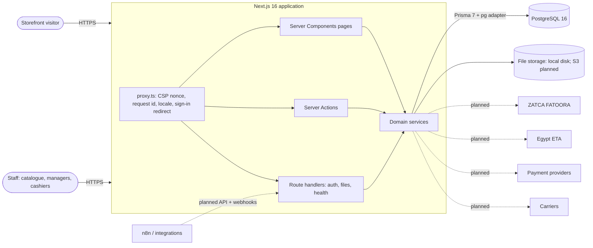

# Architecture

How the system is built and why. Decisions and their alternatives are in `docs/DECISIONS.md`; this
document describes the resulting design. Planned parts are marked **(planned)**.

## 1. Context



One deployable modular monolith (ADR-001). The browser never talks to the database or to external
services directly.

## 2. Code organisation and layering

| Layer                | Location                                             | May import                                  |
| -------------------- | ---------------------------------------------------- | ------------------------------------------- |
| Pages and layouts    | `src/app/[locale]/**/page.tsx`, `layout.tsx`         | services (read), components, `src/lib`      |
| Server Actions       | `src/app/**/actions.ts`                              | `runAction`, services                       |
| Route handlers       | `src/app/api/**/route.ts`, `sitemap.ts`, `robots.ts` | services, `src/server/db.ts`                |
| Domain services      | `src/server/modules/<module>/*.service.ts`           | `src/server/*`, `src/lib`, Prisma client    |
| Cross-cutting server | `src/server/{auth,rbac,audit,storage,actions}`       | `src/lib`, Prisma client                    |
| Shared (client-safe) | `src/lib` (schemas, money, barcode, text)            | nothing server-only                         |
| UI components        | `src/components/{ui,forms,admin,store,shared}`       | `src/lib`, **types only** from `src/server` |

Rules:

- Business rules, authorization, transactions and audit live in services. Actions only unwrap
  `FormData`/arguments and call one service; pages call read services and render.
- `server-only` guards every server module; ESLint forbids value imports of `@/server/*` and the
  generated Prisma client in `src/components/**` (type imports allowed).
- Modules today: `catalog`, `organization`, `access`, `dashboard`, `storefront`. Planned modules get
  their own folder (`inventory`, `procurement`, `orders`, `payments`, `pos`, `accounting`, `einvoicing`,
  `integrations`).

## 3. Request lifecycle

### Page request

1. `src/proxy.ts` creates a per-request nonce and CSP, a correlation id (`x-request-id`), redirects
   signed-out visitors from `/{locale}/admin…` to the sign-in page (cookie-presence check only), and
   lets next-intl resolve the locale (`/` negotiates from `Accept-Language`, Arabic fallback).
2. `[locale]/layout.tsx` validates the locale, sets `lang`/`dir`, and reads headers (dynamic render).
3. The admin layout loads the session and actor; **each admin page** calls
   `getAdminPageActor(permission)` and renders a no-access state when the actor lacks it — layouts are
   not treated as a security boundary.
4. Read services apply `assertCan` / `scopeFilterFor` and return only data within the actor's scope.

### Mutation (Server Action)

```mermaid
sequenceDiagram
  participant UI as Client form (RHF + Zod)
  participant A as Server Action
  participant R as runAction
  participant S as Service
  participant DB as PostgreSQL
  UI->>UI: validate with shared schema (UX only)
  UI->>A: call action(values)
  A->>R: runAction(ctx => service(ctx, …))
  R->>R: requireServiceContext(): session → actor reloaded from DB
  R->>S: service(ctx, input)
  S->>S: parse input with the same Zod schema (authoritative)
  S->>S: assertCan(actor, permission, target scope)
  S->>DB: BEGIN; writes; recordAudit(tx, …); COMMIT
  S-->>R: result
  R-->>UI: { ok: true, data } or { ok: false, error: { code, messageKey, params, fieldErrors } }
  UI->>UI: toast / field errors (translated), router.refresh()
```

- Domain errors (`ValidationError`, `ForbiddenError`, `NotFoundError`, `ConflictError`,
  `InvalidStateError`) become serialisable results with a message key. Unique-constraint, foreign-key
  and not-found errors from Prisma that a service did not translate are mapped generically.
- Unexpected errors are logged with the correlation id; users see only "something went wrong,
  reference …". Next.js control-flow errors (`redirect`, `notFound`) are re-thrown.

## 4. Authentication

- Better Auth (ADR-002) with e-mail/password, database sessions (12 h, refreshed hourly), cookies
  prefixed `perfume`, scrypt hashes, sign-up disabled, rate limiting in the database (sign-in: 5 per
  minute), origin/CSRF checks always on.
- A session-creation hook refuses users whose status is not ACTIVE; suspension also ends existing
  sessions. Password policy: 12–128 characters, not common, not containing the e-mail name.
- Sign-in runs through the Better Auth HTTP handler (`/api/auth/*`); sign-out and password change are
  Server Actions. Password forms POST and stay disabled until hydrated (ADR-016).
- Customer accounts are a separate, later flow (CUST-001).

## 5. Authorization

Code-defined permissions and roles, scoped role assignments (GLOBAL, COUNTRY, LEGAL_ENTITY, STORE,
WAREHOUSE), enforced in services with `assertCan(actor, permission, target)` where the target is
`"global"`, `"any"` or a concrete resource scope. List queries use `scopeFilterFor` so users only see
rows in their scope. Full model: `docs/RBAC.md`.

## 6. Audit

`recordAudit(tx, ctx, { action, entityType, entityId, summary, before, after, reason })` inside the
business transaction stores actor, IP, user agent, correlation id and a redacted diff. The table is
append-only (triggers); purging requires an explicit retention switch. Viewer: `/admin/access/audit`
(GLOBAL `audit.view`), plus per-product history built from the same log.

## 7. Data access

- Prisma 7 client generated to `src/generated/prisma`, PostgreSQL through `@prisma/adapter-pg`
  (`src/server/db.ts`). Interactive transactions run queries sequentially (no `Promise.all` inside a
  transaction — the driver serialises them and warns).
- Integrity is defended in the database as well as in services: CHECK constraints, unique indexes,
  composite foreign keys, restrictive deletes, audit triggers (`docs/DATABASE.md`).
- The storefront listing uses parameterised raw SQL (`Prisma.sql`) for price-aware sorting and paging;
  user input never reaches SQL as text.
- Search uses the normalised `products.search_text` column with a `pg_trgm` GIN index (ADR-015).

## 8. Internationalisation

next-intl with `/ar` and `/en` prefixes, Arabic default (ADR-009). Messages in `messages/{ar,en}.json`
are typed and checked for key parity by a unit test. Layout uses logical CSS properties (`ms-`, `pe-`,
`start-`), Radix `DirectionProvider`, and `rtl:` variants for icons. Fonts are self-hosted (IBM Plex Sans
Arabic, Amiri, Inter, Cormorant Garamond). Numbers and money use Latin digits; Arabic-Indic digits are
accepted on input. Bilingual business data is stored in `*_en` / `*_ar` columns and chosen with
`localized()`, falling back to the other language.

## 9. Storefront

- Market (country) chosen by an http-only cookie set by a Server Action; default from `DEFAULT_MARKET`.
- Visible products: PUBLISHED, active brand, at least one ACTIVE variant with an active price in the
  market (ADR-014). Variant selection via `?v=`; unpriced variants are shown as unavailable.
- SEO: per-page metadata, canonical and `hreflang` alternates, `sitemap.xml` (dynamic), `robots.txt`
  (dynamic, disallows admin, auth and API paths), JSON-LD `Product` with offers per market; `gtin` only
  for manufacturer barcodes; no availability claims until inventory exists.
- No cart or checkout until ORD-001; product pages state that online ordering is unavailable.

## 10. Files

`FileStorage` interface (`src/server/storage/storage.ts`) with a local-disk adapter; keys are generated
server-side and validated against a strict pattern. Uploaded images are decoded and re-encoded to WebP
by `sharp` (EXIF orientation applied, metadata dropped, max 2000 px, 5 MB input limit, 12 per product).
`/api/files/*` serves only keys registered in `product_images`, with immutable caching, `nosniff` and a
restrictive CSP. S3-compatible storage is OPS-002 **(planned)**.

## 11. Security controls

| Control                                                                            | Where                                              |
| ---------------------------------------------------------------------------------- | -------------------------------------------------- |
| CSP with nonces, `strict-dynamic`, `frame-ancestors 'none'`                        | `src/proxy.ts`                                     |
| `nosniff`, `X-Frame-Options`, `Referrer-Policy`, `Permissions-Policy`, HSTS (prod) | `next.config.ts`                                   |
| Server-side authorization on every read and write                                  | services, `src/server/rbac`                        |
| Input validation (shared schemas, size limits)                                     | `src/lib/schemas`, services                        |
| CSRF/origin checks, rate limiting, secure cookies                                  | Better Auth configuration                          |
| Secrets only from environment, validated lazily                                    | `src/lib/env.ts`, `.env.example`                   |
| No secrets or passwords in logs or audit entries                                   | `src/server/audit/redact.ts`, action error mapping |
| Safe redirects after sign-in (same-origin admin paths only)                        | `src/lib/safe-redirect.ts`                         |

## 12. Observability and operations

- Correlation id per request (`x-request-id`) propagated into audit entries and error logs.
- `/api/health` returns 200 when PostgreSQL answers, 503 otherwise (no configuration details).
- Structured logging, error tracking, metrics, backups and restore drills: OPS-003 **(planned)**.

## 13. Planned architecture (to be refined in each task)

- **Inventory (INV-001…003):** append-only stock movements plus per-warehouse stock levels updated in
  the same transaction with row locks; no negative stock (CHECK + guarded updates); unit cost recorded
  on every movement (ADR-018 proposed: weighted average cost).
- **Orders and payments (ORD-001, PAY-001/002):** price and tax snapshots on orders; stock reservations
  with expiry; payment provider adapters behind an interface; webhooks verified by signature and
  processed idempotently; no card data stored (hosted payment pages or tokenisation).
- **E-invoicing (EINV-001/002):** country adapters producing the authority formats (ZATCA UBL XML with
  stamp and QR; ETA signed JSON documents/receipts) from immutable invoice records, submitted through an
  outbox with retries; the authority's response is stored verbatim; nothing is marked submitted without
  an authority acknowledgement.
- **Integration API (INT-001):** versioned REST route handlers over the same services, API clients with
  scoped permissions (same RBAC), idempotency keys, HMAC-signed outgoing webhooks via an outbox; this is
  what n8n uses.
- **AI (AI-001):** AI features act through the integration API or services with a dedicated, limited
  role; they propose changes that staff approve; they cannot bypass validation, authorization, payment
  verification or inventory controls.
