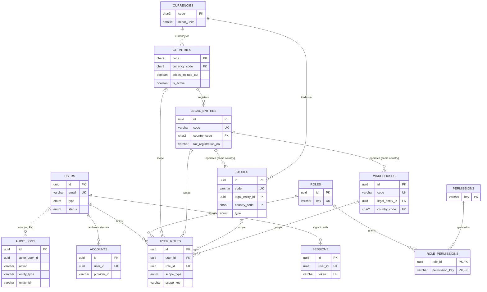
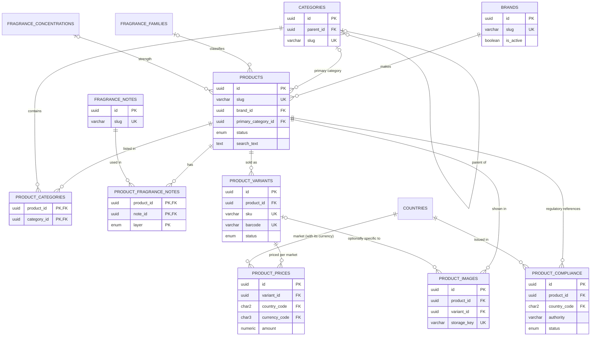
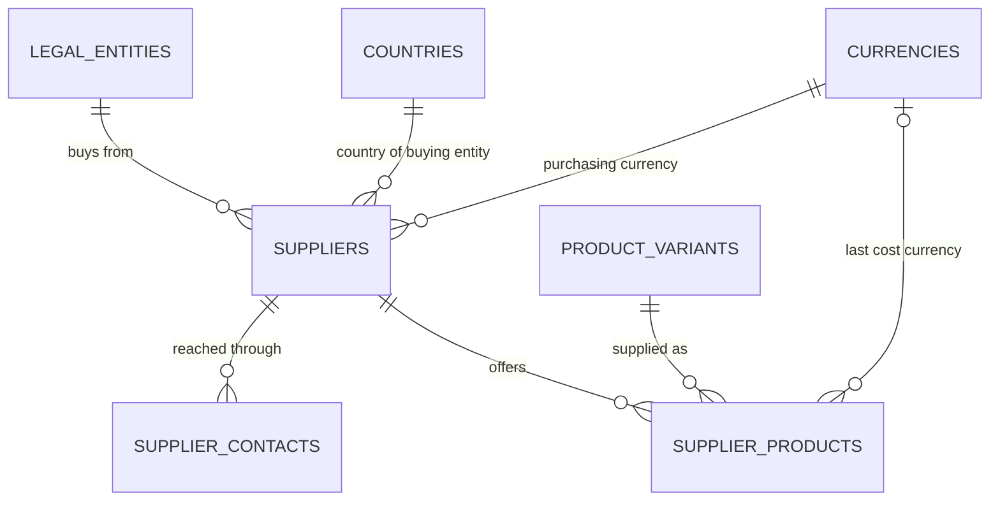
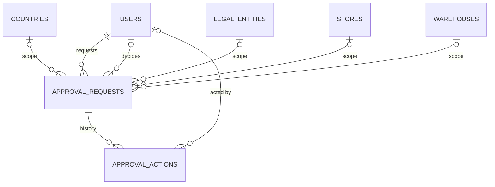
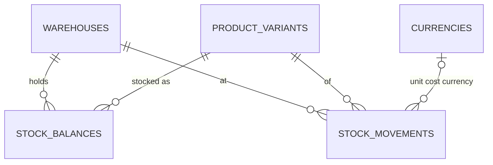
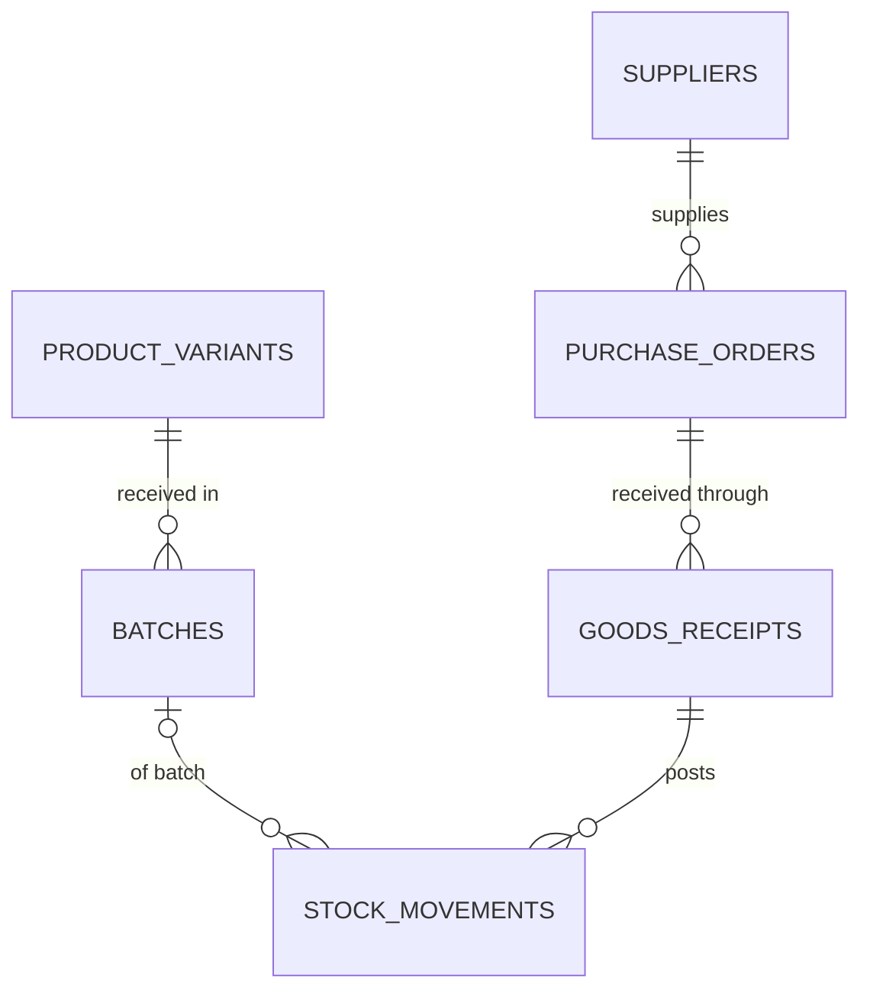

# Entity-relationship diagrams

Implemented schema (34 tables) as of migration `20261022072014_suppliers`. Columns are limited to keys and
the fields that define relationships; full definitions are in `prisma/schema/*.prisma` and
`docs/DATABASE.md`.

## Organisation and access

`verifications` and `rate_limits` (Better Auth bookkeeping) have no relationships and are omitted.
`audit_logs.actor_user_id` deliberately has no foreign key: the trail must outlive any record.

## Catalogue

`product_prices (country_code, currency_code)` references `countries (code, currency_code)`, so a
price is always in its market's currency; `(variant_id, country_code)` is unique.

## Procurement (PUR-001)

## Approvals (APR-001)

The subject (`subject_type`, `subject_id`) is a polymorphic reference without a foreign key (ADR-019).

## Inventory (INV-001)

One balance per variant, warehouse and status; movements are append-only (ADR-020).

## Phase 2 — indicative only (designed in INV-002/PUR-002)

Not implemented. The final design is recorded in `docs/DECISIONS.md` and this file when each task ends.

