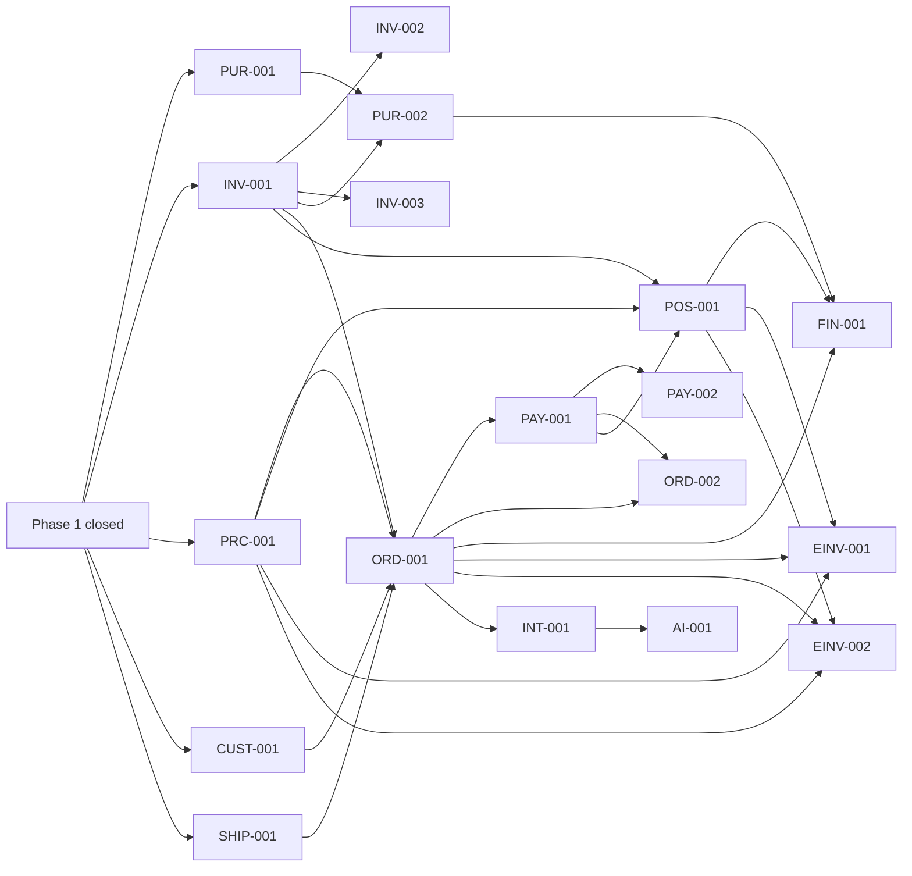

# Implementation plan

Phased roadmap. Task details live in `docs/TASK_BOARD.md`; this file holds phases, milestones, exit
criteria and verification gates. Order is driven by dependencies, then business priority and risk.

## Overview

| Phase | Goal                                     | Milestones       | Status         |
| ----- | ---------------------------------------- | ---------------- | -------------- |
| 0     | Discovery, stack choice, bootstrap       | M0               | Done           |
| 1     | Foundation + catalogue vertical slice    | M1.1, M1.2, M1.3 | Closing (M1.3) |
| 2     | Inventory and procurement                | M2.1, M2.2       | Not started    |
| 3     | Online sales: orders, payments, shipping | M3.1, M3.2       | Not started    |
| 4     | Retail point of sale                     | M4               | Not started    |
| 5     | Accounting and tax e-invoicing           | M5.1, M5.2       | Not started    |
| 6     | Promotions, loyalty, reporting           | M6               | Not started    |
| 7     | Integration API (n8n) and AI assistance  | M7               | Not started    |
| R     | Release readiness                        | MR               | Not started    |

## Phase 1 — Foundation and catalogue vertical slice

**M1.1 Foundation — Done.** BOOT-001, DB-001, AUTH-001, AUTH-002, AUD-001, I18N-001, ORG-001, ADM-001,
ACC-001.

**M1.2 Catalogue vertical slice — Done.** CAT-001, STORE-001, QA-001.

**M1.3 Phase closure — In progress (P1).** GOV-001, COMP-001, DOC-001, OPS-001, CI-001, DOC-002, DOC-003.

Phase 1 exit criteria (from the master specification) and their state:

| Criterion                                                     | State                                                        |
| ------------------------------------------------------------- | ------------------------------------------------------------ |
| Installs and starts with documented commands                  | Commands work; README pending (DOC-001)                      |
| Migrations apply to a clean database                          | Met (`migrate deploy` in test and e2e setup)                 |
| Seed runs without production credentials                      | Met (generated or `SEED_ADMIN_PASSWORD`; refuses production) |
| Authentication protects admin routes                          | Met (integration + e2e)                                      |
| Server-side authorization prevents unauthorized CRUD          | Met (service-level tests per role and scope)                 |
| Arabic RTL and English LTR render correctly                   | Met (e2e)                                                    |
| Create/edit/view/search/deactivate products and variants      | Met (integration + e2e)                                      |
| SKU and barcode uniqueness                                    | Met (DB constraints + tests)                                 |
| Prices per market and currency                                | Met (tests)                                                  |
| Database persistence                                          | Met                                                          |
| Understandable validation messages                            | Met (e2e checks messages in both languages)                  |
| Automated tests for product workflows and security boundaries | Met (108 Vitest + 16 Playwright)                             |
| Production build succeeds                                     | Met (built by the e2e run, 2026-10-21)                       |
| No inert buttons or fabricated success                        | Met by review; storefront states checkout is unavailable     |
| Required documents exist                                      | Pending (COMP-001, DOC-001…003)                              |
| CI runs the checks                                            | Pending (CI-001)                                             |

Verification gate: `npm run verify`, full Playwright run, documents reviewed against code.

## Phase 2 — Inventory and procurement

- **M2.1 Stock ledger (P2):** PUR-001, INV-001, INV-002. Exit: every quantity change is a ledger
  movement; stock levels are consistent with the ledger; no negative stock under concurrent updates
  (proven by a parallel-transaction test); batch and expiry tracking where enabled; adjustments need
  approval; everything audited and scoped by warehouse.
- **M2.2 Purchasing (P2):** PUR-002, INV-003. Exit: approved purchase orders receive stock (partial
  receipts, batches, landed cost); transfers and counts post movements.
- Parallel hardening: CAT-002, OPS-002, SEC-002.
- Decision needed before valuation work: ADR-018 (weighted average cost) confirmed by finance.

## Phase 3 — Online sales

- **M3.1 Checkout (P2):** PRC-001, CUST-001, SHIP-001, ORD-001, PAY-001. Exit: a customer in each market
  can order published, priced, in-stock products; prices and taxes are snapshotted on the order; stock is
  reserved and released correctly; COD and bank transfer are recorded and verified by staff with an audit
  trail; e-invoice obligations for each market are met (see COUNTRY_COMPLIANCE — may require M5.2 first
  for live sales).
- **M3.2 After-sales (P2):** ORD-002, PAY-002 (blocked on provider selection and credentials).

## Phase 4 — Retail point of sale

- **M4 (P3):** POS-001. Exit: cashier sessions with opening/closing balances, barcode-driven sales,
  receipts, stock decrement through the ledger, reconciliation.

## Phase 5 — Accounting and tax e-invoicing

- **M5.1 Accounting (P3):** FIN-001 after ADR-018 is confirmed.
- **M5.2 E-invoicing (P3, release-critical for live sales):** EINV-001 (ZATCA), EINV-002 (ETA). Blocked on
  taxpayer onboarding, credentials and certificates; sandbox validation before any production use.

## Phase 6 — Growth

- **M6 (P3):** MKT-001, LOY-001, RPT-001 (financial reports only after FIN-001).

## Phase 7 — Integrations and AI

- **M7 (P3):** INT-001 then AI-001. AI features use the same services and authorization as staff and
  never bypass business rules, payment verification or inventory controls.

## Release readiness

- **MR (P0 before go-live):** OPS-003, SEC-003, e-invoicing for every market where sales go live,
  legal-entity data complete (commercial registration, VAT/tax numbers, addresses), compliance register
  reviewed by a qualified advisor, backups with a tested restore.

## Verification requirements (all phases)

- Every task: lint, typecheck, unit/integration tests for its rules and authorization paths.
- User-visible flows: Playwright coverage in both languages where layout or text matters.
- Schema changes: reviewed migration (data-loss check, CHECKs and triggers kept in sync), `migrate deploy`
  on a clean database, seed still runs.
- Money, stock and payment logic: highest-effort review, concurrency tests, no floating point.
- Milestone end: `npm run verify` and the full Playwright suite; status, board and handoff updated.
