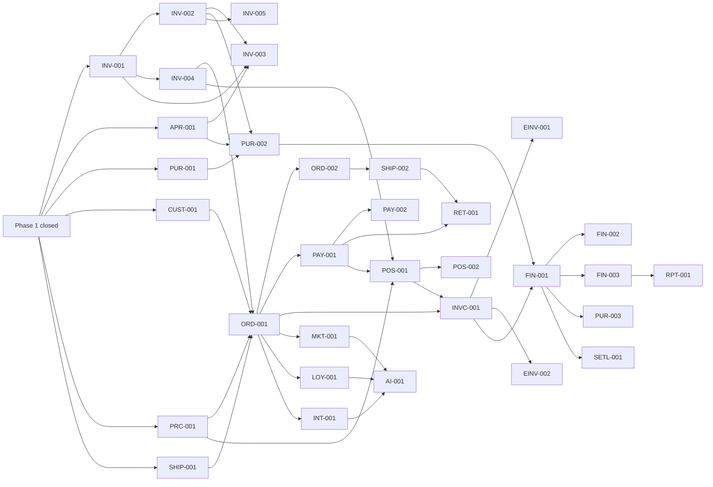

# Implementation plan

Phased roadmap following the phases of the original brief (`docs/reference/ORIGINAL_BRIEF.md` §9).
Task details live in `docs/TASK_BOARD.md`; this file holds phases, milestones, exit criteria,
sequencing decisions and verification gates.

## Overview

| Phase | Goal                                          | Status                                            |
| ----- | --------------------------------------------- | ------------------------------------------------- |
| 0     | Inspect, plan, bootstrap                      | Done                                              |
| 1     | Working foundation + catalogue vertical slice | Done                                              |
| 2     | Inventory and suppliers                       | In progress — APR-001, INV-001, PUR-001 done      |
| 3     | Storefront and orders                         | Browsing done early (STORE-001); rest not started |
| 4     | Payments, shipping, returns, POS foundations  | Not started                                       |
| 5     | Invoicing and financial foundation            | Compliance research done (COMP-001)               |
| 6     | CRM, loyalty, POS completion                  | Not started                                       |
| 7     | Reporting and automation (n8n, AI)            | Not started                                       |
| 8     | Release readiness                             | Not started                                       |

## Sequencing decisions (deviations from the brief's order, with reasons)

1. **Storefront browsing in Phase 1** (STORE-001): exercising the catalogue end to end and per market
   before inventory existed; cart, checkout and accounts remain Phase 3.
2. **Approvals framework in Phase 2** (APR-001): stock adjustments and purchase orders need approvals;
   refunds and financial postings reuse it later.
3. **Tax calculation in Phase 3** (PRC-001): checkout must snapshot taxes; invoice tax profiles and
   documents extend it in Phase 5 (INVC-001).
4. **Shipping fees in Phase 3** (SHIP-001) for checkout totals; carriers and shipments stay Phase 4.
5. **Batches before adjustments** (INV-002 before INV-003): ADR-020 adds the batch dimension with
   INV-002, so counts, adjustments and transfers are built once on batch-aware balances.
6. **E-invoicing is release-critical:** no live sales in a market before its fiscal documents comply
   (`docs/COUNTRY_COMPLIANCE.md`), even though the brief places it in Phase 5.

## Phase 0 — Inspect, plan, bootstrap — Done

BOOT-001, DB-001. Stack chosen and documented (`docs/DECISIONS.md`), tooling, migrations, safe seed.

## Phase 1 — Working foundation and catalogue slice

- **M1.1 Foundation — Done:** AUTH-001, AUTH-002, AUD-001, I18N-001, ORG-001, ADM-001, ACC-001.
- **M1.2 Catalogue slice — Done:** CAT-001, STORE-001, QA-001.
- **M1.3 Closure:** GOV-001 ✔, COMP-001 ✔, DOC-001 ✔, CI-001 ✔, DOC-002 ✔, DOC-003 ✔, OPS-001 ✔ (Docker run
  2026-10-22).

| Acceptance criterion (brief §10)                              | State                                                          |
| ------------------------------------------------------------- | -------------------------------------------------------------- |
| Installs and starts with documented commands                  | Met — README; `npm ci`, `db:deploy`, `db:seed`, `dev` verified |
| Migrations run on a clean database                            | Met — CI and e2e apply `migrate deploy` to new databases       |
| Seed works without production credentials                     | Met — generated or `SEED_ADMIN_PASSWORD`; refuses production   |
| Authentication protects admin routes                          | Met — integration and e2e tests                                |
| Server-side authorization prevents unauthorized CRUD          | Met — service-level tests per role and scope                   |
| Arabic RTL and English LTR render correctly                   | Met — e2e                                                      |
| Create, edit, view, search, deactivate products and variants  | Met — integration and e2e                                      |
| SKU and barcode uniqueness                                    | Met — DB constraints and tests                                 |
| Prices differ by market and currency                          | Met — tests                                                    |
| Changes persisted in the database                             | Met                                                            |
| Understandable validation and error messages                  | Met — e2e in both languages                                    |
| Automated tests for product workflows and security boundaries | Met — 108 Vitest + 16 Playwright                               |
| Production build succeeds                                     | Met — CI run 1 (2026-10-21)                                    |
| No inert buttons or fabricated success                        | Met by review                                                  |
| Required documentation                                        | Met — DOC-001…003                                              |

## Phase 2 — Inventory and suppliers (in progress)

Done: APR-001, INV-001, PUR-001. Order of the rest: INV-002 (Ready) → INV-003 and PUR-002 → INV-004,
INV-005. PUR-002 follows ADR-024 for cost precision and rounding.

Exit criteria: every quantity change is a ledger movement written in the same transaction as the
balance; no overselling or negative stock under concurrent operations (parallel-transaction tests);
batches with inspection/quarantine status, quarantined or rejected stock never sellable; approved,
reasoned adjustments; partial receipts; transfers and counts; reservations that expire and release;
idempotent retries; multi-warehouse capable. Brief §9 tests: partial receipts, stock shortages,
concurrent sales, rejected batches, rollback behaviour.

## Phase 3 — Storefront and orders

Tasks: CUST-001, PRC-001, SHIP-001, ORD-001, ORD-002, STORE-002 (STORE-001 done).

Exit criteria: guest and registered checkout in each market with server-recalculated prices, taxes and
shipping; price/tax/currency snapshots; stock reserved at checkout; documented order state machine with
history; customer accounts and addresses with consent; order notifications; basic order administration.
Brief §9 test: the complete product-to-order lifecycle.

## Phase 4 — Payments, shipping, returns, POS foundations

Tasks: PAY-001 (adapter interface, labelled manual/mock adapter, COD, bank transfer, webhook
idempotency), PAY-002 (real providers — blocked on selection and credentials), SHIP-002, RET-001,
POS-001. Exit: payments only confirmed by trusted evidence; duplicate webhooks harmless; shipments and
tracking; returns with disposition and refunds; POS sales through the ledger.

## Phase 5 — Invoicing and financial foundation

Tasks: INVC-001, EINV-001, EINV-002, FIN-001, FIN-002, FIN-003, PUR-003. ADR-018 and ADR-024 are Accepted
(approved by the owner, 2026-10-22); accounting approvals come from the accountant or the owner. Exit: invoices and credit notes with tax breakdowns and sequences; fiscal-document adapters
with configuration checklists, validated in authority sandboxes when credentials exist; balanced,
immutable journals; expenses; inventory cost and COGS; basic financial reports.

## Phase 6 — CRM, loyalty, POS completion

Tasks: CRM-001, LOY-001, MKT-001, REV-001, POS-002, SETL-001.

## Phase 7 — Reporting and automation

Tasks: RPT-001, AUD-002, INT-001, AI-001. AI only after core transactional flows are reliable; it never
bypasses business rules, authorization, payment verification or inventory controls.

## Phase 8 — Release readiness

Tasks: REL-001, SEC-003, OPS-003 (plus OPS-002, SEC-002, CAT-002 if still open). Full test suite,
production build, authorization and data-isolation tests, checkout/payment idempotency, inventory
concurrency, financial consistency, backup and restore, accessibility and responsive checks, dependency
audit, performance checks; document what is complete, incomplete, blocked or awaiting review.

## Verification requirements (every phase)

- Every task: lint, typecheck, unit/integration tests for its rules and authorization paths.
- User-visible flows: Playwright coverage, in both languages where layout or text matters.
- Schema changes: reviewed migration (data-loss check, CHECKs and triggers kept in sync), applied to a
  clean database, seed still runs.
- Money, stock and payment logic: highest-effort review, concurrency tests, no floating point.
- Milestone end: `npm run verify`, full Playwright suite, CI green; status, board and handoff updated.
